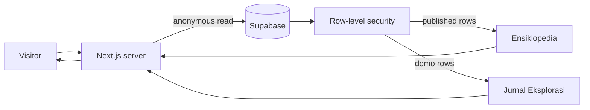

<div align="center">


# Rimba

**An Indonesian-first biodiversity encyclopedia for learning about species and conservation.**

[](./LICENSE)
[](https://nextjs.org/)
[](https://react.dev/)
[](https://www.typescriptlang.org/)
[](https://supabase.com/)
[](https://nodejs.org/)
[](https://pages.cloudflare.com/)

</div>

---

## Contents

- [About Rimba](#about-rimba)
- [Project status](#project-status)
- [How Rimba works](#how-rimba-works)
- [Journal URL controls](#journal-url-controls)
- [Technology](#technology)
- [Getting started](#getting-started)
- [Development commands](#development-commands)
- [Project layout](#project-layout)
- [Content and safety](#content-and-safety)
- [Contributing](#contributing)
- [License](#license)

## About Rimba

Rimba is an Indonesian-first biodiversity prototype for SDG 15, Life on Land. The Ensiklopedia presents published species records. Jurnal Eksplorasi shows synthetic demo observations, not personal history.

## Project status

The configured development database has four published species entries and six synthetic Journal rows: three flora, three fauna, and two record-review flags. All counts come from returned rows.

The review flag means a demo record needs review. It does not describe conservation status or expert verification. Demo dates and regions are illustrative.

Cloudflare Pages remains planned and unverified. No deployment is claimed.

## How Rimba works



`/id/species` reads published catalog entries through a server-side RPC. `/id/journal` reads demo rows through the server-side anonymous client. Zod validates database responses. No browser query uses privileged credentials.

Editors prepare and review sourced content outside the visitor app. The app has no editor interface or personal journal history. Google-only accounts support private profile creation and editing; see [account setup](docs/accounts-setup.md) for the required database migration and Auth provider configuration.

The app also has `Panduan Lapangan`, `Tentang Rimba`, and `Donasi` pages. These pages do not read Supabase. Donation is a static, non-payable demonstration with no QRIS payload or payment flow.

`Identifikasi Spesies` is paused. The app makes no AI calls and shows no simulated camera result.

### Journal URL controls

Journal state lives in the URL. Search, group, sort, and view survive reload and browser history.

| Parameter | Values and behavior                                                             | Default  |
| --------- | ------------------------------------------------------------------------------- | -------- |
| `q`       | Case-insensitive search in common and scientific names; maximum 100 code points | Empty    |
| `group`   | `all`, `flora`, or `fauna`                                                      | `all`    |
| `sort`    | `newest`, `oldest`, or `name`                                                   | `newest` |
| `view`    | `grid` or `list`                                                                | `grid`   |

Unknown or repeated keys and unsupported values show an invalid-URL message. Journal metrics use all returned rows. The result count and cards use filtered rows.

Threatened and invasive controls stay disabled because demo rows have no sourced status.

## Technology

The app uses Next.js App Router, React, TypeScript, Tailwind CSS, and next-intl. Supabase handles anonymous server-side catalog reads and cookie-based Google account sessions. Zod validates data at the database boundary. Vitest and Playwright are installed for unit and browser tests.

Indonesian is the only active locale. English messages remain dormant until routing enables that locale.

## Getting started

Requirements: Node.js `>=20.9` and npm.

```bash
npm ci
npm run dev
```

The checked-in `.env.example` contains placeholders. For Journal and species routes, create `.env.local` with `NEXT_PUBLIC_SUPABASE_URL` and `NEXT_PUBLIC_SUPABASE_ANON_KEY` for an approved development project with the required schema and data. Never commit local values.

`/id/journal` and `/id/species` need those Supabase values. `/id/guide`, `/id/about`, and `/id/donate` work without a database.

## Development commands

| Command                                  | Purpose                                                    |
| ---------------------------------------- | ---------------------------------------------------------- |
| `npm run dev`                            | Start the local Next.js server                             |
| `npm run build`                          | Create a production build                                  |
| `npm run start`                          | Serve a production build                                   |
| `npm run lint`                           | Run ESLint                                                 |
| `npm run typecheck`                      | Run TypeScript without emitting files                      |
| `npm run test`                           | Run Vitest unit tests                                      |
| `npm run test:e2e`                       | Run Playwright browser tests                               |
| `npm run test:db`                        | Run SQL and consumer checks in disposable local PostgreSQL |
| `npm run seed:validate -- <drafts.json>` | Validate a draft file without database access              |
| `npm run seed:sql -- <drafts.json>`      | Generate SQL for review without applying it                |
| `npm run format:check`                   | Check configured application-source formatting             |
| `npm run format`                         | Format configured application source and configuration     |

`npm run test:db` requires `initdb`, `pg_ctl`, and `psql` on `PATH`. It creates a temporary loopback cluster and removes it after the run. It does not use a hosted database.

## Architecture

Next.js App Router serves the Indonesian pages. The server renders catalog and Journal data from anonymous Supabase reads. Row-level security limits catalog reads to published records and Journal reads to demo rows.

The species detail resolver requires complete Indonesian content, source links, and approved media. Its single published-detail RPC also returns taxonomy; locale fallback, including media alt text, stays at the complete Indonesian entry when English is incomplete. Do not assemble partial records or fetch each card separately.

## Project layout

| Path                                    | Purpose                                                   |
| --------------------------------------- | --------------------------------------------------------- |
| `src/app/[locale]/`                     | Locale layout and route pages                             |
| `src/app/[locale]/species/(catalog)/`   | Species index and its loading/error boundaries            |
| `src/app/[locale]/species/[slug]/`      | Published species detail and localized not-found boundary |
| `src/app/[locale]/journal/`             | Journal page, local controls, and styles                  |
| `src/features/journal/`                 | Journal DTO schema and bounded query                      |
| `src/features/species/`                 | Catalog URL parsing, schemas, queries, and cards          |
| `src/i18n/`                             | Locale routing and server message loading                 |
| `src/messages/`                         | Indonesian messages and dormant English messages          |
| `supabase/migrations/`                  | Database schema and policies                              |
| `supabase/seeds/`                       | Explicit demo and research seed files                     |
| `supabase/tests/`, `tests/`, `scripts/` | SQL checks, unit/browser tests, and local tools           |
| `public/`                               | Local brand and demo images                               |

## Content and safety

- Cite scientific claims and keep evidence provenance. Record the scope and date for each conservation assessment.
- Treat occurrence and observation history separately from population counts.
- Keep the six Journal photos private and unpublished. Public reuse rights are not granted. Do not add image credits, sources, or downscale notices to the Journal cards.
- Keep media provenance privately. Review third-party media rights before any later public release; this unpublished prototype displays no image-credit, source, or resize notices.
- Do not infer conservation or invasive status from a Journal review flag. The threatened and invasive controls stay disabled until sourced data exists.
- Keep `Identifikasi Spesies` paused. Do not add AI calls, fake camera progress, or fabricated results.
- Keep `Donasi` static and non-payable. Do not add QRIS payloads, payment actions, payer data, or claimed totals.
- Keep account authentication real and Google-only. Do not fabricate personal history, activity totals, levels, badges, or editor flows.
- Keep `.env.local` and working credentials out of tracked files.

## Contributing

Contributions must stay within the requested scope. Run checks that match changed paths. Report exact commands and any behavior that remains unverified.

Run browser checks against the actual app. Screenshots or successful HTTP status alone do not prove route behavior.

## License

Rimba's original code and documentation are licensed under the [Apache License 2.0](./LICENSE). Copyright 2026 Renzie2161.

Third-party dependencies, biodiversity source material, and media retain their respective licenses. The project license does not grant rights to reuse third-party content.
