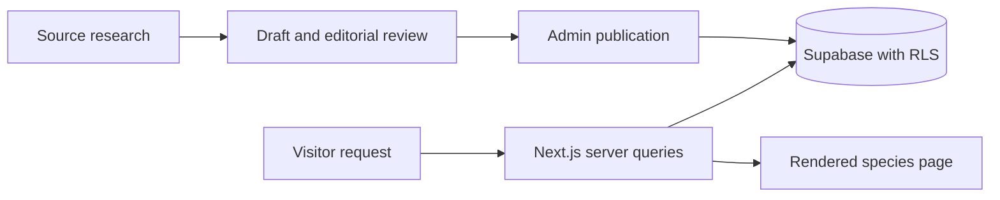

<div align="center">


# Rimba

**An Indonesian-first biodiversity encyclopedia for learning about species and conservation.**

[](./LICENSE)
[](https://nextjs.org/)
[](https://react.dev/)
[](https://www.typescriptlang.org/)
[](https://supabase.com/)
[](https://nodejs.org/)
[](https://pages.cloudflare.com/)

</div>

---

## Contents

- [About Rimba](#about-rimba)
- [Project status](#project-status)
- [How Rimba works](#how-rimba-works)
- [Technology](#technology)
- [Getting started](#getting-started)
- [Development commands](#development-commands)
- [Architecture](#architecture)
- [Project layout](#project-layout)
- [Content and safety](#content-and-safety)
- [Contributing](#contributing)
- [License](#license)

## About Rimba

Rimba is a university prototype for UN Sustainable Development Goal 15: Life on Land.

The planned encyclopedia will help visitors find species, learn about conservation, and inspect sources for published claims.

## Project status

Phase 0 delivers a responsive Indonesian-first site foundation and development tooling.

The project has no species records, search, authentication, admin tools, live database reads, or conservation pages yet. Supabase credentials are not required for this phase.

English remains inactive until reviewed translations are ready.

## How Rimba works

Rimba is designed as a curated encyclopedia, not a live wildlife tracker. Editors will turn researched material into reviewed Indonesian species profiles. Visitors will browse that published catalog without an account.

### Visitor experience (planned)

Visitors will search by common or scientific name, then narrow results by conservation status, habitat, or region. A species profile will connect its taxonomy, habitat, threats, and conservation information to named sources.

Conservation categories will describe a specific assessment, not a live population count. Missing facts will remain unknown. Photos will include attribution and license details, with a typographic fallback when suitable media is unavailable.

Related conservation campaigns will provide educational context. Their QRIS demonstration will use a non-payable code and temporary browser memory. Refreshing will reset it, without collecting money or payer details.

Photo identification is a later optional feature for selected taxa. It will suggest candidates with uncertainty, not confirm an identification.

### Content preparation and publication (planned)

1. Research Indonesian endemic and threatened taxa using authoritative assessments and taxonomic references.
2. Prepare Indonesian drafts with citations, assessment context, and licensed media or a designed fallback.
3. Review taxonomy, factual claims, image rights, and copy. The project owner approves the initial batch before publication.
4. Publish approved entries. Public access must exclude drafts and unapproved supporting content.

Curators will edit drafts. Admins will control publication and changes to published content. External biodiversity services will support research and imports rather than become mandatory dependencies for each visitor request.

### What happens today

The browser requests a page from Next.js, which renders the Indonesian home shell using local message dictionaries. Small client-side controls handle the language disclosure and light/dark theme.

The catalog is intentionally empty. No route fetches species, authenticates users, or contacts Supabase. The data and editorial flows above describe planned behavior, not existing integrations.

## Technology

The app uses Next.js App Router, React, TypeScript, Tailwind CSS, and next-intl. Vitest and Playwright cover unit and browser behavior.

Rimba includes environment validation and a lazy, server-only anonymous Supabase client. No route uses it for live data or authentication.

Cloudflare Pages is a requested deployment target. No deployment is configured or tested.

## Getting started

Requirements: Node.js `>=20.9` and npm.

```bash
npm ci
npm run dev
```

Open `http://localhost:3000`. The Phase 0 site runs without Supabase credentials.

## Development commands

| Command                | Purpose                                               |
| :--------------------- | :---------------------------------------------------- |
| `npm run dev`          | Start the local Next.js server                        |
| `npm run build`        | Create a production build                             |
| `npm run start`        | Serve the production build                            |
| `npm run lint`         | Run ESLint                                            |
| `npm run typecheck`    | Run TypeScript without emitting files                 |
| `npm run test`         | Run Vitest unit tests                                 |
| `npm run test:e2e`     | Run Playwright browser tests                          |
| `npm run format`       | Format application source and configuration files     |
| `npm run format:check` | Check application source and configuration formatting |

Install Chromium once before browser tests: `npx playwright install chromium`.

## Architecture

Next.js App Router handles pages, layouts, metadata, and route states. Server Components provide the default rendering model. Interactive controls use client components.

The planned data flow is:



Typed server-side queries will validate filters and retrieve published records. Supabase row-level security will enforce access independently of UI controls. The existing server-only client is a starting point, not a working data layer.

## Project layout

| Path            | Purpose                                                        |
| :-------------- | :------------------------------------------------------------- |
| `src/app/`      | Site routes, layouts, and loading, error, and not-found states |
| `src/i18n/`     | Locale routing and navigation                                  |
| `src/lib/`      | Environment validation and server-only Supabase client         |
| `src/messages/` | Locale message dictionaries                                    |
| `tests/unit/`   | Fast contract tests                                            |
| `tests/e2e/`    | Browser routing and interaction checks                         |
| `public/`       | Brand images, including the rounded README mark                |

## Content and safety

- Source every biodiversity claim. Keep unassessed or unknown conservation status explicit.
- Use media only when its taxon, license, alt text, and attribution are correct.
- Keep QRIS non-payable and local-only. Do not collect payer data or show real payment totals.
- Keep `.env.local` and working credentials out of commits. Use a separate development Supabase project.

## Contributing

Run formatting, lint, type checks, unit tests, and a production build before a change is complete. Run browser tests for route or interaction changes.

Include a short change summary and the exact checks you ran with each pull request.

## License

Rimba's original code and documentation are licensed under the [Apache License 2.0](./LICENSE). Copyright 2026 Renzie2161.

Third-party dependencies, biodiversity source material, and media retain their respective licenses. The project license does not grant rights to reuse third-party content.
